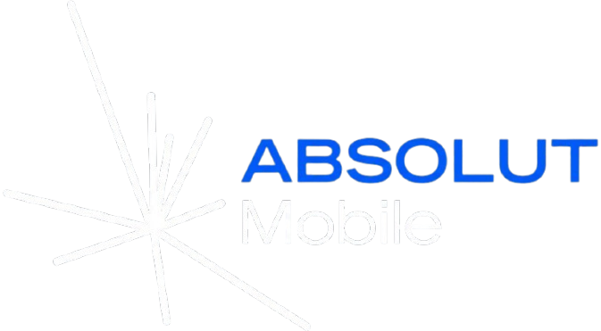

  <!-- Puedes reemplazar este enlace por la URL o ruta local real del logo de tu empresa -->
  
  
  ---
  [Sitio web de Absolut Mobile](https://www.absolutmobile.com.ar/)

---

## 📖 Sobre el Proyecto

Este proyecto contiene el código fuente de la página web oficial para **Absolut Mobile**. Diseñado con un enfoque moderno, limpio y bien estético, su objetivo principal es dar a conocer la empresa, presentar lo que hacemos y permitir que los clientes se comuniquen de manera rápida y sencilla.

## 🚀 Características

- **Diseño Atractivo y Fachero:** Una interfaz visualmente agradable y directa para la mejor experiencia del usuario.
- **Formulario Funcional:** Sistema de contacto rápido y seguro integrado directamente en la landing page.

## 🛠️ Tecnologías y APIs

- **Maquetado:** Estructura web estándar (HTML/CSS/JS).
- **Procesamiento de Formularios:** Integración con la API de **w3school** para gestionar el procesamiento y el envío de mensajes desde el formulario de contacto de la página.

## Versión

**v1.0.0** 

---

  Programado y diseñado por <b>TC</b>

